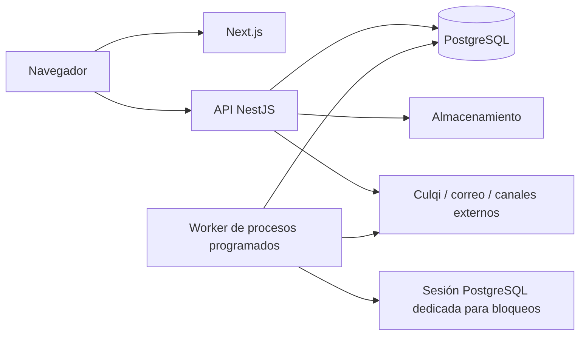

# Revisión técnica y correcciones

Fecha: 9 de noviembre de 2026. Base Git: `d275783`, con numerosos cambios locales previos conservados.

La plataforma comercializa cursos y gestiona matrículas, clases, evaluaciones, pagos, contratos y comunicaciones. Usa un monolito modular NestJS, Next.js y PostgreSQL/Prisma. La carga considerada incluye alumnos trabajando simultáneamente, varias pestañas por cuenta y un worker separado del servidor HTTP.

**Estado: correcciones implementadas; pruebas unitarias, E2E de API, migraciones, compilaciones y lint ejecutados en Docker aislado. Quedan pendientes navegador, carga e integraciones externas. Este documento no certifica la capacidad de producción ni constituye una auditoría exhaustiva de seguridad.**

## Alcance y arquitectura

Se revisaron la estructura, los puntos de entrada, el esquema y las migraciones, la configuración de despliegue y CI, y el inventario de pruebas. La lectura más profunda se concentró en autenticación, sesiones, pagos, bloqueos, tareas programadas y comunicación. También se inspeccionaron contratos, matrículas, aula, soporte, almacenamiento, consultas de informes y los procesos del cliente para autenticación, notificaciones y caché.

No se leyó cada línea de cada componente. La revisión y sus pruebas no accedieron al despliegue ni realizaron cobros, correos o publicaciones reales. Las migraciones y el seed de prueba se ejecutaron exclusivamente en una base desechable con datos ficticios. La actualización operativa posterior, solicitada por el usuario, se registra al final. No se modificaron dependencias.



Conviene conservar la separación modular existente. Los problemas encontrados requieren corregir invariantes y procesos concretos; no justifican dividir ahora toda la aplicación en microservicios.

## Cambios implementados

Los resultados de esta tabla describen el comportamiento del código modificado. Las suites de regresión unitarias y de API se ejecutaron con los resultados indicados abajo; esto no sustituye pruebas de navegador, carga o proveedores reales.

| Área y código principal | Problema identificado | Corrección | Efecto y precaución |
|---|---|---|---|
| Sesiones: `backend/src/modules/auth/infrastructure/refresh-session.service.ts`, `strategies/jwt.strategy.ts` | Un JWT conservaba acceso y permisos aunque su sesión o cuenta cambiara. | Los JWT emitidos por los endpoints incluyen el hash identificador de su sesión. Cada solicitud valida vigencia, revocación, cuenta activa y permisos actuales en PostgreSQL. El JWT final contiene solo identificadores. | Cerrar una sesión invalida su acceso. Las cookies antiguas requieren renovación o nuevo inicio de sesión. Se añade una consulta de autorización por petición. |
| Reutilización de refresh tokens: `refresh-session.service.ts` | La revocación de las otras sesiones se hacía dentro de una transacción que luego lanzaba una excepción y revertía esa revocación. | El rechazo ocurre después de confirmar la transacción. | La revocación deja de perderse por rollback. La política existente sigue revocando las sesiones del usuario ante reutilización. |
| Recuperación y cambios de credenciales: `auth.controller.ts`, `prisma-user.repository.ts` | Dos solicitudes podían consumir el mismo token de recuperación. Cambiar credenciales no invalidaba necesariamente el acceso ya emitido. | El cambio de contraseña exige que el token siga vigente y sin consumir en la propia escritura; la misma operación revoca sesiones. Cambiar contraseña, deshabilitar la cuenta o cambiar sus roles revoca sesiones. El logout también puede revocar mediante el JWT si falta la cookie de renovación. | Evita sobrescrituras concurrentes y conserva la revocación junto al cambio de credenciales. |
| Renovación en el navegador: `frontend/src/lib/api.ts` | Dos pestañas podían renovar a la vez y disparar la detección de reutilización. Las rutas protegidas bajo `/auth/` no intentaban renovar. | Web Locks coordina las pestañas y una revisión compartida evita renovar dos veces las mismas cookies. Solo los endpoints de inicio/fin y recuperación de sesión omiten la renovación. | No se guardan tokens en localStorage. La coordinación entre pestañas depende de Web Locks y almacenamiento compartido disponibles en el navegador. |
| Eventos privados: `communication/session-events.ts` y gateways | Los sockets solo verificaban la firma al conectar. El cierre local usaba una estructura de Socket.IO incorrecta para un namespace. El worker no dispone de servidor Socket.IO. | Se valida la sesión al conectar, al recibir acciones de chat y antes de entregar datos privados. Se corrige el acceso al mapa de sockets y se limpian temporizadores. La entrega en vivo no interrumpe la persistencia de notificaciones; el worker omite la emisión si no tiene servidor. | Una sesión revocada no debe seguir recibiendo eventos privados. La distribución entre procesos sigue pendiente de infraestructura compartida. |
| Notificaciones del cliente: `frontend/src/components/dashboard/notifications-bell.tsx` | Los avisos generados por el worker podían no aparecer hasta recargar. Los eventos podían duplicarse y crecer sin límite en memoria. | Se consulta al abrir el panel y al reconectar; se deduplican eventos y se conservan como máximo 50 elementos. Se añade nombre accesible y estado expandido al botón. | Los avisos persistidos pueden consultarse aunque no llegue un evento en vivo. No se verificó visualmente en navegador. |
| Administración de pagos: `academic/application/services/payments.service.ts` | Aprobar y rechazar simultáneamente podía sobrescribir el estado. Correos y analítica se disparaban antes del commit. | Las escrituras exigen que el pago siga pendiente y sin cobro incierto. Las confirmaciones y analítica quedan después del commit; un fallo de analítica no convierte un pago aprobado en una respuesta de error. | Solo una transición concurrente puede ganar. Esto no implementa una cola durable de correo. |
| Cobros inciertos: `payments.service.ts` | Tras un timeout, una búsqueda sin resultados podía habilitar otro cargo. Una respuesta HTTP 5xx liberaba el intento aunque el proveedor pudiera haber cobrado. | Un resultado incierto exige conciliación y no habilita automáticamente otro cargo. Las respuestas inciertas conservan el intento. Las llamadas a Culqi tienen un timeout de 15 segundos. | Reduce el riesgo de doble cobro. Un pago incierto puede requerir revisión manual; no debe desbloquearse sin comprobar el proveedor. |
| Importes: `payments.service.ts` | La conciliación y los eventos de cargo no comprobaban siempre importe y moneda. | Se contrastan los céntimos y la moneda PEN antes de activar la matrícula; se aceptan los nombres `currency_code` y `currency` documentados por Culqi. | Un evento con importe o moneda incompatibles no debe activar la matrícula. Falta validar fixtures reales sanitizados de la integración. |
| Bloqueos: `shared/infrastructure/scheduler/scheduler-lock.service.ts`, `prisma/prisma.module.ts` | El trabajo se ejecutaba fuera de una transacción de bloqueo con timeout predeterminado de cinco segundos. Había proveedores de bloqueo separados por módulo. | Un servicio global usa una conexión de sesión dedicada, sin reciclaje por inactividad, y bloqueos explícitos hasta terminar. Evita reentrada local, intenta liberar incluso si la tarea falla, conserva el error original y espera trabajo activo al cerrar. | Requiere conexión directa o pooling en modo sesión y una conexión adicional por proceso. Una pérdida de sesión detiene nuevas adquisiciones y exige reiniciar el worker. |
| Worker y certificados: `worker.ts`, `automation.service.ts`, `certificate-scheduler.service.ts` | El worker omitía automatizaciones; algunos errores periódicos quedaban sin manejar. Los certificados lanzaban todo el lote simultáneamente. | Se incluyen los cinco procesos, se manejan errores de intervalos, se evita superponer el mismo trabajo local y se espera antes de cerrar. Los certificados se consultan por páginas de 100 y se emiten de cinco en cinco. Prisma se desconecta después de la destrucción de módulos. | Reduce presión de memoria y conexiones. El tiempo total y las interrupciones deben medirse con una base aislada. |
| Contratos: `rrhh/rrhh.service.ts` | Firmar, devolver y aprobar podían competir sobre estados leídos previamente. Dos aprobaciones del mismo trabajador podían dejar contratos activos incompatibles. | Las transiciones exigen el estado de origen en la escritura. La aprobación bloquea primero la fila del trabajador para serializar sus aprobaciones. | Hace consistente la aprobación concurrente entre procesos que usan este flujo. Falta comprobarlo contra PostgreSQL real. |
| Caché PWA: `frontend/public/sw.js` | Se almacenaban imágenes y respuestas de Next.js por categorías amplias en una caché compartida entre cuentas. La activación eliminaba cachés de otras aplicaciones del mismo origen. | Solo se interceptan recursos públicos explícitos y navegaciones con fallback a `/offline`. Se eliminan únicamente cachés antiguas con el prefijo de la academia. | Los archivos privados y datos de API dejan de entrar en esta caché. Los recursos compilados usan su caché HTTP habitual. |

## Pendientes antes de crecer

1. **Completar navegador e integración con proveedores.** Ya pasaron las suites unitarias y de API, las migraciones y ambos builds. Falta recorrer las pantallas con un navegador real y validar los contratos de proveedores en un entorno de integración autorizado. Mantener fuera de esos entornos los `.env` reales y sus credenciales. Las pruebas existentes no acreditan todos los flujos posibles.

2. **Compartir el estado antes de añadir réplicas HTTP.** `app.module.ts` utiliza el almacenamiento predeterminado del throttler y los gateways no configuran un adaptador distribuido. Varias réplicas tendrían límites independientes y eventos que no llegan a sockets de otras réplicas. El worker tampoco publica en los sockets del proceso HTTP. Hace falta almacenamiento compartido de límites y un adaptador/emisor distribuido; el transporte y balanceador deben configurarse juntos. Además, 120 solicitudes por minuto por IP y cinco intentos de login por minuto pueden afectar aulas completas detrás de una misma IP. Definir una política para usuarios autenticados y tráfico anónimo, y probarla. [Adaptadores NestJS](https://docs.nestjs.com/websockets/adapter).

3. **Reducir la contención del aula.** `evaluation/application/services/classroom.service.ts` usa un bloqueo exclusivo por evaluación para intentos, respuestas, entregas y calificación. Muchos estudiantes guardando respuestas en la misma actividad se serializan. Separar el bloqueo por estudiante del bloqueo de edición de la evaluación, conservando coordinación entre ambos y relecturas dentro de la transacción. La prueba debe enfrentar distintos estudiantes y dos solicitudes del mismo estudiante.

4. **Paginar el resto del trabajo masivo y los informes.** `automation.service.ts` toma siempre hasta 200 prospectos/pagos y 500 matrículas, sin recorrer las siguientes páginas. Puede dejar fuera registros más allá del primer lote. Los recordatorios cargan destinatarios anidados y varias exportaciones de `reports.service.ts` cargan colecciones completas. Recorrer por cursor estable, agregar importes en SQL y generar exportaciones grandes por streaming o trabajo en segundo plano. Los certificados ya tienen paginación y concurrencia acotada, pero el resto de procesos aún no.

5. **Completar conciliación y recuperación de pagos.** La conciliación consulta solo los primeros 100 cargos del proveedor. El nuevo bloqueo evita repetir un cobro incierto, pero no garantiza encontrar cargos fuera de esa página. Añadir paginación acotada, verificación del estado definitivo del proveedor y tratamiento explícito de reservas vencidas. Los cargos tardíos rechazados localmente necesitan un proceso operativo de devolución o regularización; marcar `REJECTED` no devuelve dinero. Validar también webhook y conciliación compitiendo por el mismo pago. [API de Culqi](https://apidocs.culqi.com/).

6. **Medir capacidad y durabilidad de entregas.** Los canales externos siguen teniendo operaciones en memoria, sin una outbox transaccional que garantice recuperación tras caída. Las métricas HTTP son una ventana limitada por proceso, no contadores globales durables. El script de carga actual mide hasta recibir cabeceras y debe consumir la respuesta para medir la transferencia completa. Preparar datos representativos y medir CPU, RAM, conexiones, latencia p95/p99, errores, 429 y colas; un número de peticiones concurrentes no equivale a un número de usuarios soportados.

## Validación ejecutada con Docker

| Comprobación | Resultado final |
|---|---|
| Pruebas unitarias y umbral de cobertura del backend | **87 suites, 432 pruebas aprobadas** |
| Cobertura de sentencias / ramas / funciones / líneas | **94,77 % / 76,32 % / 91,97 % / 94,95 %** |
| Pruebas E2E de la API con PostgreSQL 15 | **5 suites, 23 pruebas aprobadas** |
| Migraciones desde una base vacía | **27 migraciones aplicadas**; seed ficticio completado |
| Compilación del backend | Aprobada |
| Compilación del frontend con Next.js/Turbopack | Aprobada; **52 páginas estáticas generadas** |
| Lint del backend | **0 errores, 186 advertencias** que siguen pendientes |
| Lint del frontend | Aprobado, sin mensajes |
| Comprobación estática TypeScript | Aprobada en backend y frontend |

Se comprobaron con PostgreSQL real el rechazo de una cookie retenida tras logout, la revocación de otras sesiones después de reutilizar un refresh token y el consumo único de un token de recuperación con solicitudes simultáneas. Una prueba con dos conexiones verificó que un trabajo mantenía su bloqueo después de 5,5 segundos, impedía ejecutarlo desde la otra conexión y permitía adquirirlo después de liberarlo. También pasaron compra, matrícula y concurrencia por cupos.

Durante esta ejecución se corrigieron dos puntos adicionales: el caso E2E de precios ahora crea y elimina su propia cohorte, y la liberación de un bloqueo conserva el error original si también falla el desbloqueo. Se eliminó un tipo sin uso y se normalizó el formato requerido por el lint del backend.

Las pruebas utilizaron dependencias ya presentes en las imágenes locales, cuyos `package-lock.json` coincidían con los del proyecto. El esquema del cliente Prisma coincidía con el actual ignorando comentarios y espacios. Antes de retirar la copia temporal, se compararon **438 archivos** de código y pruebas con los del proyecto: no había diferencias.

El entorno excluyó `.env`, sesiones guardadas, archivos privados y credenciales reales. Se usaron raíz y herramientas de solo lectura, una copia desechable del código, usuario sin privilegios, variables ficticias explícitas, red externa bloqueada y límites de dos CPU, 3 GiB de RAM, 2 GiB de escritura temporal y 600 segundos por ejecución. El PostgreSQL temporal no publicó puertos y compartió únicamente su namespace de loopback con las pruebas de API. El build de Next.js se limitó a un trabajador para respetar esos recursos.

Al terminar se eliminaron el contenedor PostgreSQL temporal, los dos volúmenes de dependencias de prueba y la copia temporal del código. Los servicios y volúmenes de la aplicación se conservaron.

**No ejecutado:** pruebas Playwright en navegador, pruebas visuales, carga sostenida, auditoría actualizada de dependencias e integración real con Culqi, SMTP o WhatsApp. Las imágenes de prueba utilizadas no incluyen un navegador Linux preparado. No se descargaron herramientas adicionales porque la habilidad [security-audit](C:/Users/ALUMNO/.codex/skills/security-audit/SKILL.md) indica: “Use only tools and dependencies already available locally”. Las pruebas de navegador requieren preparar esa herramienta bajo las mismas condiciones de aislamiento.

Comandos equivalentes para un runner aislado con PostgreSQL de prueba y proveedores simulados:

```text
backend: npm test -- --runInBand --no-cache
backend: npm run test:cov -- --runInBand --no-cache
backend: npm run lint
backend: npm run test:e2e -- --runInBand
backend: npm run build
frontend: npm run lint
frontend: npm run build
frontend: npm run test:e2e
```

Las pruebas E2E de escritura deben usar una base desechable. La validación de Culqi debe usar fixtures o su entorno de integración autorizado, nunca cargos reales. Antes de publicar, comprobar `DIRECT_URL`, el presupuesto de conexiones y la política de reinicio del worker. Una conexión perdida o un failover puede liberar un advisory lock antes de terminar una llamada externa; sus efectos deben ser idempotentes. [Bloqueos PostgreSQL](https://www.postgresql.org/docs/15/explicit-locking.html).

## Dictamen

La estructura modular es aprovechable y las correcciones pasaron la validación unitaria, de API y de compilación descrita. Antes de producción faltan navegador e integraciones; antes de varias réplicas y mayor volumen faltan estado compartido, menor contención del aula, paginación masiva y recuperación durable. Todavía no existe una cifra de usuarios simultáneos demostrada.

## Actualización de los contenedores existentes

El 9 de noviembre de 2026 se reconstruyeron y recrearon `academia_virtual_backend` y `academia_virtual_frontend`, conservando su configuración activa del Compose base y el almacenamiento local. PostgreSQL, ClamAV y Cloudflare mantuvieron sus contenedores; los montajes de datos del backend no cambiaron.

- Se creó `backups/pre-container-update-20261109-174455.dump` antes de la actualización y se comprobó que su índice de archivo era legible. Está excluido de Git.
- Las imágenes anteriores se conservaron con la etiqueta `pre-update-20261109-174455` en ambos repositorios locales.
- Se verificó la coincidencia de los lockfiles y se reutilizaron las dependencias de esas imágenes para reconstruir sin acceso de red. No se descargaron paquetes.
- Se corrigió `backend/Dockerfile` para resolver las dependencias de Prisma desde la ubicación del esquema mediante un enlace a las dependencias del backend, con instalación automática deshabilitada. Se amplió `.dockerignore` para excluir secretos, respaldos y archivos subidos del contexto de construcción.
- Ambos contenedores terminaron en estado **healthy**, con las imágenes nuevas activas y cero reinicios al comprobarlos. Se contrastaron huellas del código de sesiones, bloqueos, API del navegador y service worker con los archivos del proyecto.
- La web y la salud de la API devolvieron **HTTP 200** tanto en local como en las direcciones públicas configuradas. El service worker local también devolvió HTTP 200 con la versión nueva.

La comprobación operativa fue de salud y respuestas HTTP. No incluyó iniciar sesión con cuentas reales, ejecutar operaciones de negocio reales, pruebas de navegador ni carga sostenida.
